# How conversations work

> **Status:** sections 1–3, 5 and 6 were reviewed against the code on 2026-10-01 (Conversation Host
> 0.8.0, forge-runner 0.19.0, ForgeAPI 0.7.0); line numbers in them may have drifted since. The
> `forge run` decisions and section 4 were reviewed on 2026-11-18 against forge-mcl `4a364da` and
> forge-client `main`. This doc explains a Forge conversation from end to end: a turn, storage,
> live events, the client, Hands, and failure.

Repos are named by their short name (`forge-conversations`, `forge-runner`, …). Paths without a
repo prefix are in `forge-conversations/src/ForgeMission.ConversationHost/`; other paths name their
repo. An *inference* is a claim not checked in code or live; it is marked where it appears.

## `forge run` decisions

Locked by the operator in Phase 76 (2026-11-02 to 2026-11-15) and still in force. If code and this
table disagree, ask the operator; do not infer from git history.

| Decision | Rule |
|---|---|
| Project file | Every run needs `forge.project.json` (or `--project <file>`); without one, `forge run` stops with a clear message. `forge project create` writes it. There is no mission version pinning and no `<Mission>@1` declaration. |
| Hands folders | Hands may touch only the folders listed in `folders`; a new project lists `"."`. An unlisted folder is unreachable; an empty list means no Hands access, with no fallback. A relative path resolves against the first listed folder; an absolute path may target any listed folder (forge-mcl `WorkspaceGuard.TryResolve`). Hands is always on; `folders` is its only permission, with no consent prompt or flag. |
| One client path | `forge run` opens the project, creates a new conversation each launch, attaches Hands, submits one turn and follows it to the end through forge-client. No flag, mode or check lives only in the CLI. The local history copy under `~/.forge/sessions` is written by forge-client's open step. |
| Complete turn | The client returns every expert step (attempt and output), Hands requests and results, errors and the final answer; the caller chooses what to show. `forge run` prints the final answer to stdout unchanged (plus a newline), diagnostics and the conversation ID to stderr, and one verbose flag renders the turn's detail to stderr. The full record stays in the Conversation Host. |
| Code steps | A mission may mix `exec`, `onnx` and similar code steps with `llm` steps. Code runs in the cloud runner as part of the brain; Hands governs client tool calls only. There is no "contains code" marker. |
| State ownership | The Conversation Host owns durable state: event log, mission content, input bytes, output files. The runner keeps only scratch and re-reads from the Host (the brain/session split of Anthropic's [Managed Agents design](https://www.anthropic.com/engineering/managed-agents)). |
| Inputs | `forge run <mission> "<prompt>"` fills the mission's one parameter. Named inputs (`--input name=value`, `--input name=@file`) go through forge-client's `UploadInputAsync` and named `Artifacts`; `@file` is one file up to 100 MiB, and a folder is refused. `--input` cannot name the root input. |
| Config file | On first use `forge` writes `~/.forge/config.json` with `api.endpoint` (default `https://api.forge.katasec.com`) and `oci.endpoint` (default `ghcr.io/katasec`), keeping settings already there. A fully qualified OCI reference works without changing it. If the file cannot be written, `forge` stops at startup. |
| Deleted | `forge exec`, `--mode`, the stateless one-shot `ExecuteMission` path, and forge-client's mission version lifecycle (drafts, candidates, evaluations, approvals, submissions). |

## Overview

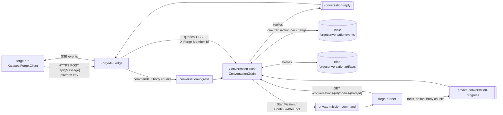

| Part | Owns | Talks to |
|---|---|---|
| Client (`forge run`) | Local project, Hands (Bob), printing | ForgeAPI only (`/api/{MessageName}`) |
| ForgeAPI edge | Nothing durable; auth, credit check, body chunking | Ingress/reply queues; direct Host queries (`forge-platform/src/ForgeMission.Api/Conversations/ConversationEndpoints.cs`) |
| Conversation Host | Every conversation: state, events, bodies, live fan-out | Table, Blob, all four conversation queues |
| forge-runner | Nothing durable except Service Bus session state | Command and progress queues; Host body route |

Commands go over Service Bus; queries (including the event stream) are direct HTTP reads
([command-bus architecture](command-bus-architecture.md)). The Host has internal ingress only;
the edge sets the member header (Host `README.md` → Identity).

---

## 1. A turn's life

Two words used below: an **owed** command is one the grain has committed to send but not yet
sent; to **drain** the outbox is to send every owed command and record each as sent
([section 6](#outbox-and-reminder)).

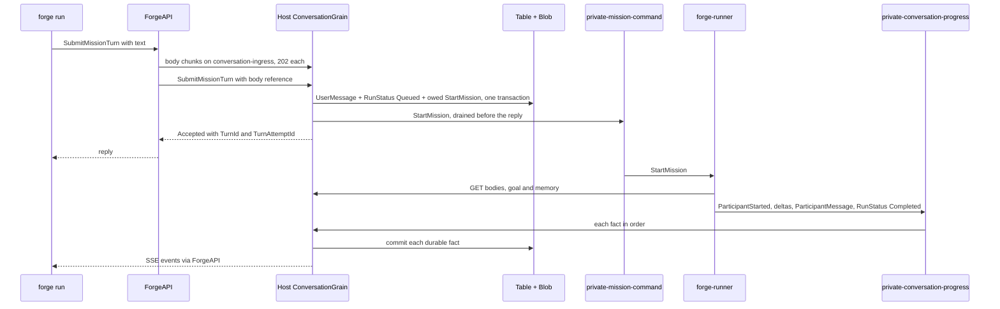

1. **Submit.** The client posts `SubmitMissionTurn` to ForgeAPI. The edge first rejects a missing
   body (400) or one over 4 MiB (413), then checks credit, then sends the text as body chunks,
   waits for a 202 per chunk, and sends the command with a body reference
   (`forge-platform/src/ForgeMission.Api/Conversations/ConversationEndpoints.cs:130-145`;
   `Messaging/Ingress/ConversationIngressHandler.cs:78`). The edge waits up to 30 s for the
   Host's reply (`forge-platform/…/Conversations/ConversationCommandBus.cs:68`).
2. **Accept.** The grain rejects a second turn while one is active (`RunAlreadyActive`,
   `Grains/ConversationGrain.cs:305`). Otherwise it composes memory (prior turns, 32 KiB budget)
   and commits `UserMessage` + `RunStatus: Queued` + an owed `StartMission` in one transition
   (`PlanRunStart`). The turn's attempt id is the run id.
3. **Dispatch.** Still inside the same call, after the commit, the grain drains the outbox: it
   sends `StartMission` (`MessageId` = `CommandId`) and records it as sent. Only then does it
   reply (`ConversationGrain.cs:1348-1352`). So `Accepted` means the command is on the queue, or
   still owed with a reminder to retry it.
4. **Run.** The runner reads the goal and memory through the Host body route, runs the mission
   through Core, and publishes facts in order on the conversation's session of the progress queue
   (`forge-runner/src/ForgeMission.Runner/Conversations/MissionCommandProcessor.cs`).
5. **Record.** Each fact is one grain commit; each committed event goes to live readers. The turn
   ends at a terminal `RunStatus`: Completed, Failed or Interrupted.

**Cancelling a turn** (`CancelMissionTurn`) commits `RunStatus: Interrupted` ("Cancelled by
operator") for the active attempt, which ends the active run (`ConversationGrain.cs:351-379`). No
command goes to the runner. Inference: the runner finishes its current work; its later facts for
that run are rejected because the run is no longer active (`RejectProgress`,
`ConversationGrain.cs:793`) and the progress consumer completes rejected messages.

---

## 2. Storage

### One commit = one entity-group transaction

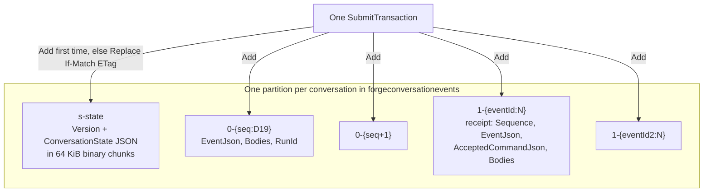

The partition key is `v1|{tenant}|{conversationId:N}`. `ConversationGrain` is a
`JournaledGrain<ConversationState, ConversationTransition>` on Orleans' `CustomStorage` provider
(`Grains/ConversationGrain.cs:46`, `Program.cs:82`). The grain itself is the storage adapter:
`ReadStateFromStorage` reads the `s-state` row; `ApplyUpdatesToStorage` writes the state row, the
new event rows and their receipt rows in **one** Table transaction
(`Persistence/AzureTableConversationEventStore.cs:59-81`). Either all rows land or none do, so
there is no crash gap between "event written" and "state saved". `PendingTransition` and grain
storage are gone.

| Row | Key | Holds |
|---|---|---|
| State | `s-state` | Journal `Version`, the serialized state in 64 KiB binary chunks (max 960 KiB) |
| Event | `0-{sequence:D19}` | Public event JSON (max 30 KiB, bodies excluded), body references, run id |
| Receipt | `1-{eventId:N}` | Sequence, event JSON, the accepted command (max 32 KiB) — answers "already accepted?" |

Limits are in `Persistence/ConversationJsonLimits.cs`. The 30 KiB event cap keeps JSON inside a
Table string property (32K UTF-16 units).

### Conditional events

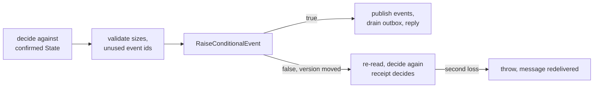

Every mutating call goes through `CommitTransitionAsync` (`Grains/ConversationGrain.cs:1330-1361`).
It never uses unconditional `RaiseEvent`, because Orleans would retry that on top of newer state
without re-validating. A conditional event that loses (412 on the state ETag, or 409 on the
first-write Add) is re-decided once; on the retry the receipt row turns a duplicate into
"already accepted". A method returns only after its commit is confirmed, so queue consumers
complete a message only once it is durable.

### Bodies in Blob (claim-check)

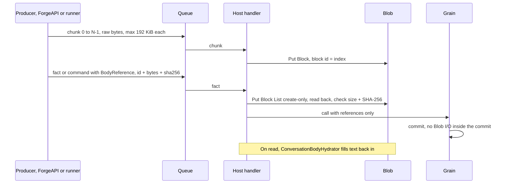

Every string a user, model or tool sizes (messages, error reasons, tool arguments and results,
goals, the runner's continuation, composed memory) is a **body**. It is stored once in Blob at
`{tenant}/{conversationId:N}/bodies/{bodyId:N}` (`Persistence/AzureBlobConversationBodyStore.cs:86`).
The event row keeps a reference. Body ids are deterministic per owning fact and field, so a
retry writes the same blob. The grain's **commit** does no Blob I/O; the grain does touch Blob in
two places outside the commit (below).

| Step | Where |
|---|---|
| Edge chunks client text; over 4 MiB → 413 before any send | `forge-platform/…/Conversations/ConversationEndpoints.cs:119-192` |
| Runner sends chunks before the fact on the progress session | `forge-runner/…/Conversations/MissionCommandProcessor.cs` (Outbox) |
| Put Block per chunk, Put Block List create-only, verify size + SHA-256 | `Persistence/AzureBlobConversationBodyStore.cs:28,131`; `Api/ConversationBodyIntake.cs` |
| Missing chunks: progress → Error + Failed; ingress → 400 `bodyIncomplete` | `Messaging/ConversationProgressHandler.cs:79-93`; Host README |
| Memory (`MissionInput`): composing it reads prior bodies; the grain writes it to Blob at dispatch, from committed state, just before the send | `ConversationGrain.cs:1421-1425` |
| Hydrate on every read: events, SSE, snapshot, run history, hands work | `Persistence/ConversationBodyHydrator.cs` |
| Runner reads command bodies | `GET /conversations/{id}/bodies/{bodyId}` (`forge-conversations/src/ForgeMission.Conversations.Contracts/ConversationBodies.cs:79`; `forge-runner/…/Conversations/ConversationHostBodyReader.cs`) |

**Why 4 MiB** (`forge-conversations/src/ForgeMission.Conversations.Contracts/ConversationBodies.cs:22`):
it is a guardrail, not a storage limit. A body over ~1M tokens is larger than a model context;
model replies are at most ~512 KB; client text is untrusted input (Phase 54 B2). Service Bus
Standard caps a message at 256 KB, hence 192 KiB chunks.

---

## 3. Live events

### Fan-out: grain → observers → hub → SSE

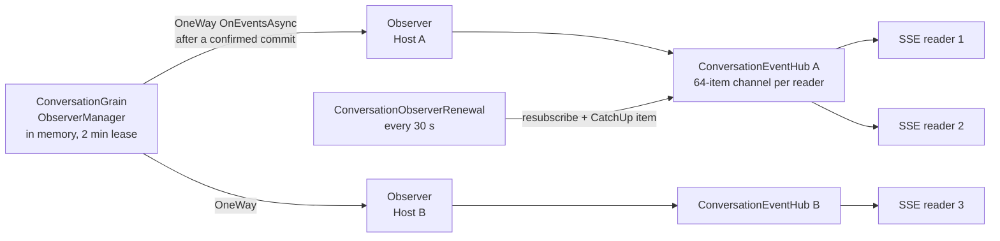

- Each Host keeps one observer per conversation it has readers for. The first reader subscribes
  it on the grain; the last one leaving unsubscribes it (`Api/ConversationEventHub.cs:10-22`).
- The grain notifies observers one-way after a confirmed commit, so a dead or slow Host never
  blocks a commit (`Grains/IConversationEventObserver.cs:16`, `ConversationGrain.cs:888`).
- The observer list lives in memory and is lost if the grain reactivates elsewhere. Every 30 s
  each Host resubscribes and tells its readers to catch up from the Table
  (`Api/ConversationObserverRenewal.cs`). So a lost list costs at most ~30 s of live delay, never
  a lost durable event.
- A reader whose 64-item channel is full is dropped; its stream ends and the client reconnects.

### SSE cursor and gap rule

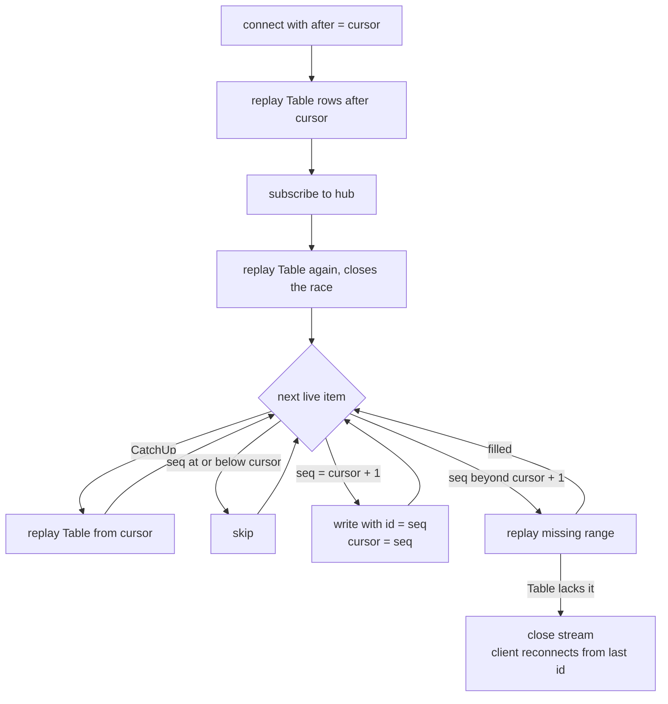

Sequences are contiguous, so the writer only ever writes `cursor + 1`
(`Api/ConversationSseWriter.cs:73-117`). A live event further ahead means a publish was missed (an
ambiguous commit publishes nothing), so the gap is filled from the Table first. Writing it directly
would move the client's `id:` past an event it never saw. Each event is hydrated before writing.

### Deltas

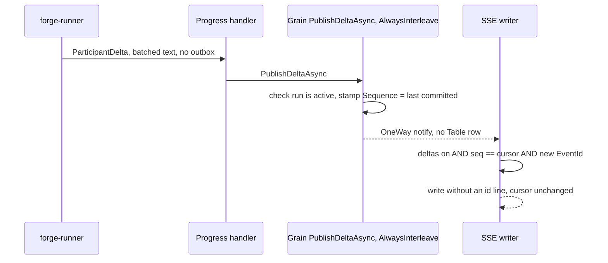

| Rule | Where |
|---|---|
| Runner batches: first chunk at once, then every 200 ms or 16K chars; flushed before the step's final message | `forge-runner/…/Conversations/ConversationDeltaBatcher.cs` |
| Never stored: no row, no state, no memory; `RecordProgressAsync` rejects a delta; dead-letter ignores it | `ConversationGrain.cs:782`; `Messaging/ConversationProgressDeadLetterHandler.cs` |
| `[AlwaysInterleave]`: a delta never waits behind a commit held in storage | `Grains/IConversationGrain.cs:77` |
| Written only with `deltas=true` and `Sequence == cursor`; no `id:`; never moves the cursor | `Api/ConversationSseWriter.cs:91-96` |
| Redelivered delta written once per connection (last 128 ids) | `Api/ConversationSseWriter.cs:150` |
| Opt-in through ForgeAPI `IncludeDeltas` (older clients fail on the unknown kind) | `forge-platform/…/Conversations/ConversationEndpoints.cs:277-280` |

A delta stamped at N while a commit to N+1 is in flight is dropped by the cursor rule. That is
harmless: the step's final `ParticipantMessage` is the durable record.

---

## 4. The `forge run` client

`forge run` (forge-mcl `src/ForgeMission.Cli/Commands/ForgeDurableRun.cs`) prepares the mission
package, then hands everything else to forge-client's shared path
(`src/ForgeMission.Application/Missions/ProjectConversation.cs`); the rules are in
[`forge run` decisions](#forge-run-decisions).

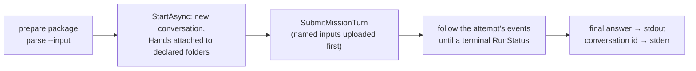

1. **One conversation per launch.** `StartAsync` opens the project, creates a new mission
   conversation whose launch is pinned to `ProjectWorkspace` when the project lists folders and
   `NoHands` when it lists none (`MissionConversationService.cs:46-56`), and attaches Hands.
2. **One turn.** The client submits one `SubmitMissionTurn` with a fresh command id. Named inputs
   (`--input`) are uploaded as content first (`UploadInputAsync`).
3. **Follow.** The client streams the conversation's events from its cursor. Only events stamped
   with this turn's attempt id (`RunId`) are shown and collected; every event also reaches the
   Hands driver. A delta is shown only after its step started on the same connection, and never
   moves the cursor. The turn ends at a terminal `RunStatus` (`Completed`, `Rejected`,
   `Interrupted`, `Failed`).
4. **Result.** On `Completed` the final answer is the last top-level `ParticipantMessage`; it is
   printed to stdout and the exit code is 0. Otherwise the exit code is 1. `--verbose` prints every
   event to stderr (`RunTranscript.cs`); without it only error events are printed.

### Reconnect

A stream that closes cleanly is reopened from the cursor after a short delay, so no durable event
is lost or repeated. A transport failure is thrown and ends the run with `run failed: …` (backlog:
Follow reconnects).

### Ctrl-C

Ctrl-C cancels the run's token. The client first cancels any Hands operation in flight, then cancels
this turn attempt on the Host (`MissionConversationService.CancelAsync`), then exits. Disposing the conversation stops following,
stops Hands and closes the session; it does not cancel a turn on the Host.

---

## 5. Hands

Hands let a mission read and change files on the user's machine. The Host only coordinates; the
local client (Bob, in forge-client) executes.

### Profiles

| Profile | Tools the runner declares | Used by |
|---|---|---|
| `NoHands` | none | `forge run` when the project lists no folders |
| `ProjectWorkspace` | Read, Write, Edit | `forge run` when the project lists folders (a new project lists `"."`) |
| `ProjectWorkspaceAndTerminal` | Read, Write, Edit, Bash | defined; no default client uses it |

The runner declares tools with Core's `AgentToolDeclarations`, which have real JSON schemas
(`file_path` required) (`forge-runner/…/Conversations/GenericDurableMissionExecutor.cs`). Core
gives tools only to `role: agent` experts (`forge-mcl/src/ForgeMission.Core/Runtime/PipelineRunner.cs`). A mission conversation's launch,
and so its profile, is pinned at creation; every hands attachment must match that immutable pin
(`ConversationGrain.DecideMissionConversationCreate` and `DecideAttachMissionHands`).

There is no consent prompt and no flag: the project's `folders` are the only permission.

### Attachment handoff

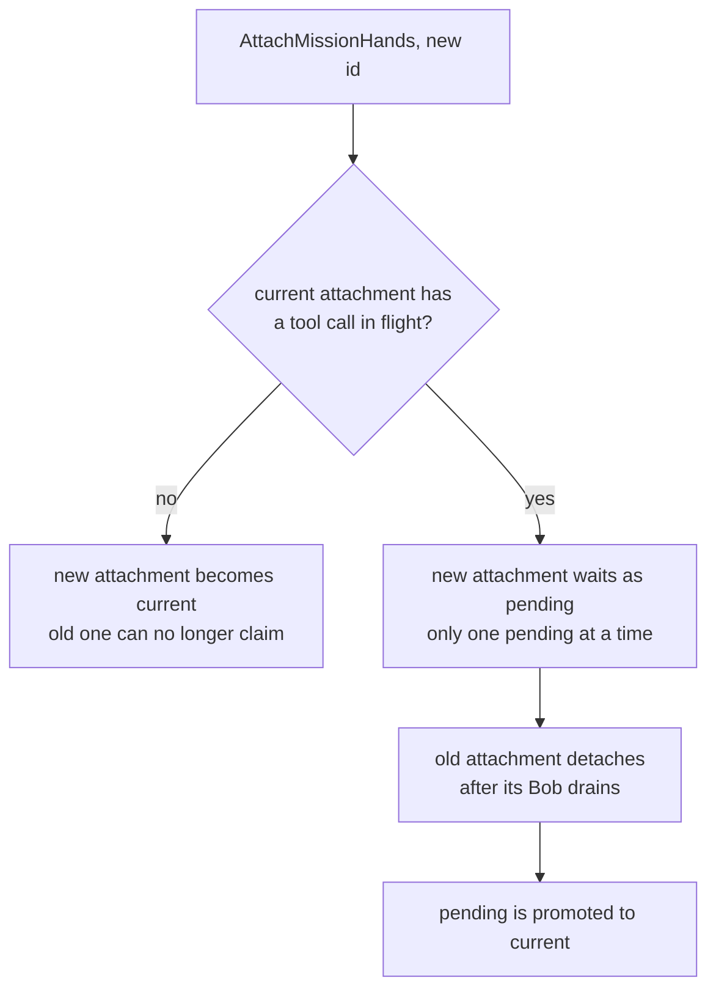

There is one current attachment per conversation. A new attach replaces it at once when no tool
call is in flight; otherwise it waits as pending until the old one detaches
(`ConversationGrain.cs:455-469, 472-494`; `Grains/ConversationState.cs:170-177`). A claim from any
attachment that is not current is refused (`ConversationGrain.cs:646-648`).

### The hands loop

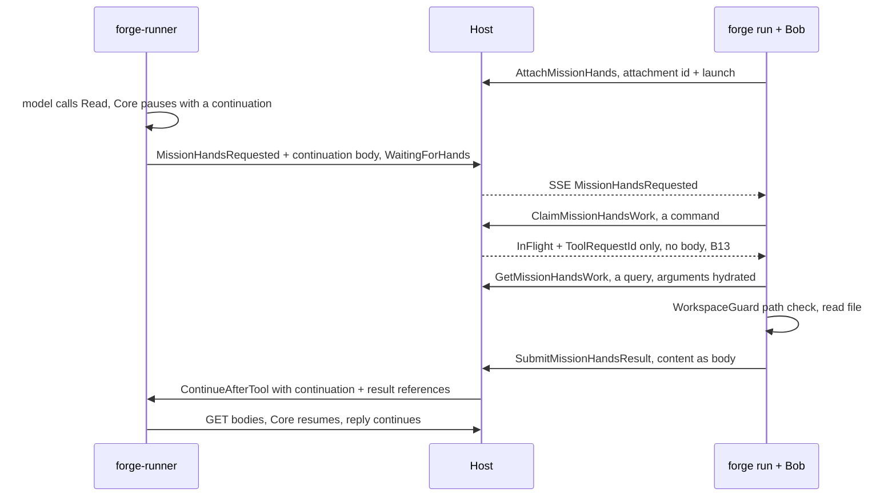

| Step | Rule | Where |
|---|---|---|
| Attach | One current attachment; see [handoff](#attachment-handoff) | `ConversationGrain.cs:432-494` |
| Request | Host accepts a request only if it matches the active start command and the pinned launch | `ConversationGrain.cs:800-818` |
| Claim then read (B13) | Command replies never carry bodies (they ride the 256 KB reply queue). The claim returns status and the request id; Bob reads the work item by query | `ConversationGrain.cs:629-663`; `forge-client/src/ForgeMission.Application/Missions/MissionHandsConversationService.cs:214-228` |
| Execute | Driven by the event stream: every followed event reaches the Hands driver, and each `MissionHandsRequested` starts one Execute | `forge-client/src/ForgeMission.Application/Missions/MissionHandsDriver.cs` |
| Path guard | Relative paths resolve under the first declared folder; anything resolving outside is refused; symlinks are followed on every existing ancestor. A path guard, not an OS sandbox | `forge-mcl/src/ForgeMission.Core/Tools/WorkspaceGuard.cs` (used by forge-client ClientRuntime via `LocalDiskWorkspace`) |
| Result | The result commit owes exactly one deterministic `ContinueAfterTool` | `ConversationGrain.cs:534-592` |
| Resume | Runner refuses a resume if the run is not `WaitingForHands`, or the package hash or engine build changed | `forge-runner/…/Conversations/MissionCommandProcessor.cs:145-162` |
| Fingerprint | Core hashes tool schemas in compact JSON at pause and at resume, so schema whitespace cannot break a continuation (fixed in Core 0.1.3) | `forge-mcl/src/ForgeMission.Core/Runtime/PipelineRunner.cs:741-749` |
| Exit mid-tool | Ctrl-C cancels the local Hands operation, then the turn attempt on the Host | `forge-client/…/Missions/ProjectConversation.cs` (`RunAsync`) |

Proven live on the default path with `forge run` (Phase 79, 2026-11-18): Hands wrote
`phase79-proof.txt` in the project folder (conversation `ea6195a6-249e-5891-9ca0-269409315a49`).

---

## 6. Failure and recovery

### Outbox and reminder

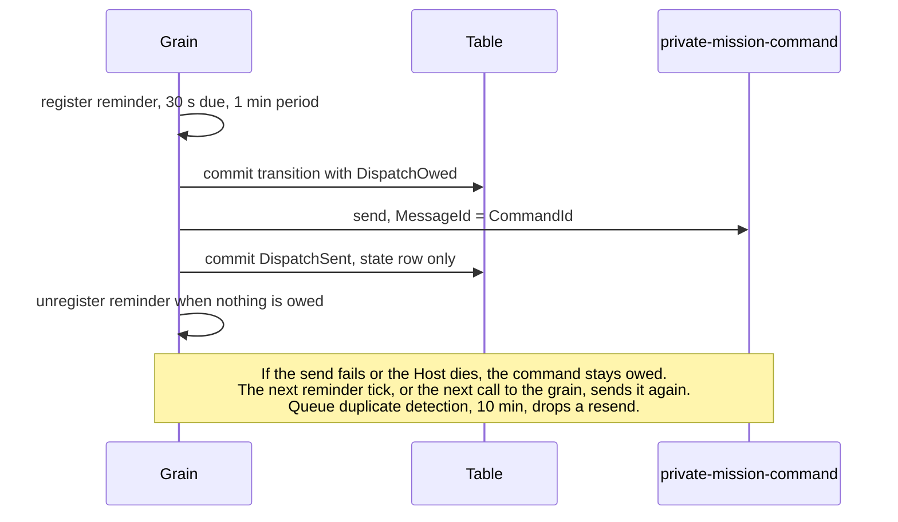

Service Bus cannot join the Table transaction, so the owed command is made durable first
(`ConversationGrain.cs:1343-1348, 1413-1440`). The reminder is registered **before** the commit, so
an owed command always has a retry driver. Activation does not drain the outbox (the grain has no
`OnActivateAsync`).

### Dead-letter

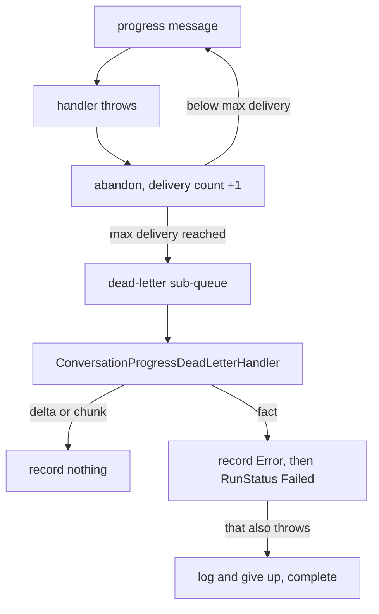

A dead-letter sub-queue has no further delivery limit, so the handler never throws: if recording
the failure itself fails, it logs and completes (`Messaging/ConversationProgressDeadLetterHandler.cs`).
A dead-lettered chunk records nothing; its fact then finds the body incomplete and fails the run.

### Host restart or rollover mid-turn

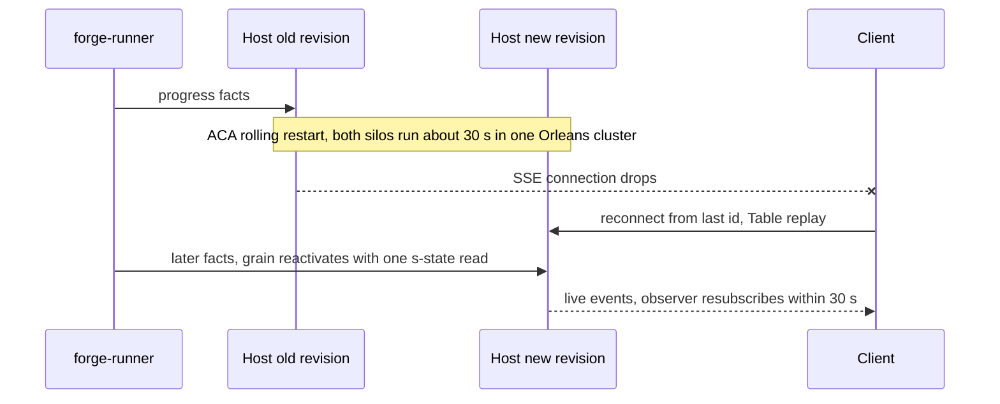

| Situation | What happens | Lost |
|---|---|---|
| Host restart mid-turn | The runner owns the run outcome and is unaffected. The grain reactivates with one `s-state` read and makes no grain calls, so it cannot deadlock. Progress resumes from the queue. | Live deltas during the gap |
| Revision rollover (~30 s, two silos) | Silos form one cluster. A write from a stale activation fails the ETag check and is re-decided. The observer list is rebuilt by the 30 s resubscribe + catch-up. | Live deltas; up to ~30 s live delay (durable events arrive by catch-up) |
| Runner restart mid-turn | Redelivered command after the provider call started → run `Interrupted` (no silent retry of a paid call) | The turn ends Interrupted |
| Runner never reports | The run stays active until the user cancels the turn (Host README → Run outcome) | — |
| Progress handler keeps failing | [Dead-letter](#dead-letter): `Error` then `Failed`; if that also fails, log and give up | The turn ends Failed |
| Missing body chunk | Progress fact → `Error` + `Failed`; ingress command → 400 `bodyIncomplete` | The turn ends Failed |
| Table outage | Orleans retries the commit with backoff and never throws. The caller times out (30 s; 2 min for `RecordProgressAsync`), the message is abandoned and redelivered, and the receipt makes the redelivery a no-op | Nothing committed |
| Blob outage | The handler throws before the grain call → broker redelivery. An SSE read that cannot load a body ends the stream; the client reconnects | Nothing committed |
| Slow SSE client | Its 64-item channel fills, the stream ends, the client reconnects from its cursor | Nothing committed |

Progress runs up to 8 conversations at once, one message at a time per conversation, so one stuck
conversation does not stall others (`Messaging/ConversationProgressConsumer.cs:27`).

**In short:** no committed fact is lost. A turn can end Failed or Interrupted; live deltas can be
dropped.

---

## Not covered yet / known gaps

| Gap | Note |
|---|---|
| Typed "not the current attachment" claim reject | The Host refuses a non-current attachment with the same untyped reason as other refusals (`ConversationGrain.cs`), so a client cannot tell them apart. Backlog. |
| Turn cancel and the runner | The runner is not told; inference: it finishes its work and its later facts are rejected ([section 1](#1-a-turns-life)). |
| Host replica count is 1 | The design is correct for N silos (tested with 2); scaling out is a separate decision (`forge-infra/dev/terraform/apps.tf`, `conversation_host` `min_replicas`/`max_replicas`). |
| Runner processes one conversation at a time per replica | `MaxConcurrentSessions = 1` (`forge-runner/…/Conversations/AzureServiceBusMissionCommandConsumer.cs:91`); 1–3 replicas, minimum 1 so the queue consumer always runs (`forge-infra/dev/terraform/apps.tf`, `runner` `min_replicas`/`max_replicas`). Inference: replicas scale on HTTP traffic, not queue length. |
| Orphan body blobs | A body blob committed but never referenced by a grain commit stays (Phase 54 B4). Staged blocks never committed expire after 7 days (Phase 54 B7). |
| Resends after the 10-minute duplicate-detection window | Not deduplicated by the queue; inference: the runner's session state (same `CommandId`) turns a late resend into a no-op or `Interrupted`. |
| Not covered live | A transport failure mid-follow; Hands Edit and cancel mid-tool. |
