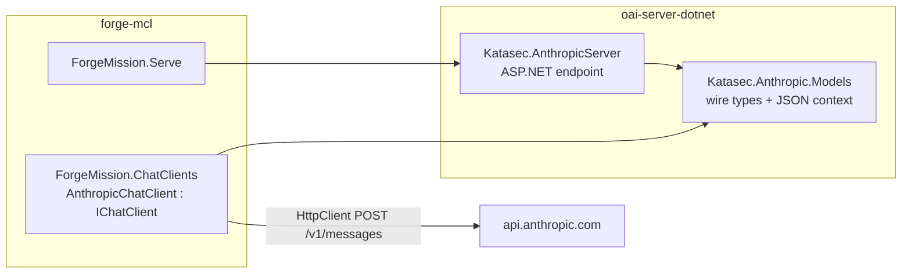

# Phase 77 — forge's own Anthropic client

> **Status: design locked 2026-11-02; no task started.** Next: Task 1.

## Problem

`tryAGI.Anthropic` 3.8.3 is the only Anthropic dependency in forge, and it is much larger than what
forge uses. On the 2026-11-01 osx-arm64 build it made **55 MB of the 82.7 MB of native code** in
`forge`. The TUI made 3 MB. forge calls one endpoint, `POST /v1/messages`, plain and streamed.

The package also gets in the way. forge-mcl already wraps it in about 300 lines because it drops or
ignores things forge needs:

| tryAGI gap | Current workaround in forge-mcl `src/ForgeMission.ChatClients/` |
|---|---|
| Ignores `ChatOptions.ResponseFormat` and `AllowMultipleToolCalls` | `AnthropicResponseFormatChatClient.TranslateNativeOptions` builds a native request (`ChatClients.cs`) |
| Sends a 250-token limit when none is set | `EnsureModelId` sets 4096 |
| Streaming keeps only text: no usage, no stop reason, no tool calls | `AnthropicTextStream.cs` handles plain text only; tool-mode streams still lose usage and tool calls ([backlog: Streamed tool calls](../backlog.md)) |
| Error text is in the body, `Message` is just "Bad Request" | `AnthropicProviderError.cs` ([Phase 69](phase-69-provider-error-message.md)) |

forge already has Anthropic Messages wire types that are safe under Native AOT:
`Katasec.AnthropicServer` (katasec/oai-server-dotnet) defines the request, response, content
blocks, usage and every streaming event, with a source-generated `AnthropicJsonContext`. Those types
were written for `forge serve`, which receives Anthropic requests, so they are already compiled into
`forge`. Nothing in them is server-specific.

## Locked design (operator, 2026-11-02)



| Decision | Value |
|---|---|
| Owner | forge-mcl `ForgeMission.ChatClients`. Provider types still never reach Core (its README rule). Core, forge-runner code and forge-client do not change. |
| Shared types | New package **`Katasec.Anthropic.Models`** in oai-server-dotnet (`src/Katasec.Anthropic.Models`). It holds the types in today's `AnthropicModels.cs` and `AnthropicJsonContext`, namespace `Katasec.Anthropic.Models`. It has no ASP.NET and no Microsoft.Extensions.AI reference, and `IsAotCompatible` is true. `Katasec.AnthropicServer` references it and keeps only the endpoint and mapping code. |
| Why a separate package | `ForgeMission.ChatClients` ships as NuGet `Katasec.Forge.Mcl.ChatClients` (used by forge-runner). Referencing `Katasec.AnthropicServer` directly would pull ASP.NET Core into every user of the client. |
| Type names | Keep today's class names (`AnthropicRequest`, `AnthropicResponse`, `AnthropicContentBlock`, …). Change the section comments from "Inbound/Outbound" to "Request/Response", because the client and server see them from opposite sides. |
| Added fields | Every added field is nullable and `JsonIgnore(WhenWritingNull)`, so the server's JSON output does not change. See [Type additions](#type-additions). |
| Client | `internal sealed class AnthropicChatClient : IChatClient` in ChatClients, built by `ChatClients.BuildAnthropicClient`. It replaces `AnthropicResponseFormatChatClient`, `AnthropicTextStream` and the tryAGI package. `AnthropicProviderError` stays and works from the HTTP status and body. |
| Files | `AnthropicChatClient.cs` sends requests and reads responses. `AnthropicMessageMapping.cs` translates between `ChatMessage`/`ChatOptions` and the wire types. `AnthropicStream.cs` turns SSE into `ChatResponseUpdate`. `AnthropicProviderError.cs` builds the user-facing error. Delete `AnthropicTextStream.cs`. |
| Wire | `POST {endpoint}messages`. `endpoint` is `profile.Endpoint` when set, otherwise `https://api.anthropic.com/v1/`. Headers: `x-api-key: <profile.ApiKey>`, `anthropic-version: 2023-06-01`, `content-type: application/json`. No beta headers. |
| HTTP | One static `HttpClient` per process, over a `SocketsHttpHandler` with `PooledConnectionLifetime = 2 min`. forge-runner builds a client for every run, so a new `HttpClient` each time would exhaust sockets. Default 100 s timeout. Streams use `HttpCompletionOption.ResponseHeadersRead`. Caller cancellation passes through. |
| Retries | None. A failed call fails the step, as it does today. tryAGI 3.8.3 has no retry handler either (no Polly; a string scan of the DLL shows only API model names containing "Retry"). That is an inference from the scan, not a test. |
| Serialization | Only `AnthropicJsonContext` typeinfo, `JsonDocument` and `Utf8JsonWriter`. No reflection-based `JsonSerializer` calls. Build stays `-warnaserror` with zero trim/AOT warnings. |
| Thinking | forge does not send `thinking`. The client ignores `thinking` and `redacted_thinking` blocks, and `thinking_delta` and `signature_delta` events. That is tryAGI's behaviour today for forge's use. |
| Versions | oai-server-dotnet publishes every package at one version through `publish.yml` (`workflow_dispatch`). Add a pack line for the models project and publish **0.2.0**. The namespace move breaks source compatibility for `Katasec.AnthropicServer` users. ChatClients moves to **0.2.0**: its public API is unchanged, but the provider error's inner exception type changes. forge-client's test fixture stays on AnthropicServer 0.1.8. It has no reason to move. |

### Type additions

| Type | Add | Wire name |
|---|---|---|
| `AnthropicRequest` | `ToolChoice` (new `AnthropicToolChoice { Type, Name?, DisableParallelToolUse? }`) | `tool_choice` → `type`, `name`, `disable_parallel_tool_use` |
| `AnthropicRequest` | `StopSequences` `List<string>?`, `Temperature` `float?`, `TopP` `float?`, `TopK` `int?` | `stop_sequences`, `temperature`, `top_p`, `top_k` |
| `AnthropicRequest` | Make `Tools` nullable with WhenWritingNull, so a call without tools does not send `"tools":[]`. The server reads null as no tools. | `tools` |
| `AnthropicContentBlock` | `ToolUseId` `string?`, `Content` `JsonElement?`, `IsError` `bool?` | `tool_use_id`, `content`, `is_error` |
| `AnthropicUsage` | `CacheCreationInputTokens` `int?`, `CacheReadInputTokens` `int?` | `cache_creation_input_tokens`, `cache_read_input_tokens` |
| new `AnthropicErrorResponse` | `Type`, `Error { Type, Message }` | `{"type":"error","error":{"type","message"}}` |
| new `AnthropicStreamError` | `Type`, `Error` (same shape) | SSE `event: error` |
| `AnthropicJsonContext` | Register every new type, plus `List<string>` and `List<AnthropicContentBlock>` (already present) | — |

`AnthropicContentBlock.Text` defaults to `string.Empty`. The client must set it to `null` on
non-text blocks, or the request would carry `"text":""` on a `tool_use` block. Leave the default
alone so the server's output stays unchanged.

### Request mapping (`ChatMessage` / `ChatOptions` → `AnthropicRequest`)

| Input | Wire |
|---|---|
| `ChatRole.System` messages | `system`: their text joined with `"\n\n"`, as a JSON string. Omitted when empty. Same as today. |
| `TextContent` in user or assistant messages | `{type:text, text}` |
| `FunctionCallContent` in an assistant message | `{type:tool_use, id: CallId, name, input}`. Arguments are written with `Utf8JsonWriter`: a `JsonElement` value is written as-is (`WriteTo`), and `string`, `bool` and number values directly. Any other type is serialized with `AIJsonUtilities.DefaultOptions`, which is MEAI's AOT-annotated resolver. If that has no typeinfo, throw `InvalidOperationException` naming the type. |
| `ChatRole.Tool` messages with `FunctionResultContent` | One `user` message carrying all the `{type:tool_result, tool_use_id: CallId, content, is_error}` blocks from consecutive tool messages. `content` is a string: the result if it is a string, the raw JSON text if it is a `JsonElement`, otherwise serialized as above. `is_error` is `true` only when `Exception` is set. |
| Any other content (`DataContent`, `UriContent`, …) | Throw `NotSupportedException` naming the content type. No forge source creates these today (checked 2026-11-02 across forge-mcl, forge-runner and forge-client). |
| `ModelId` / profile model | `model` |
| `MaxOutputTokens` | `max_tokens`. 4096 when unset, as today. |
| `Tools` (`AIFunctionDeclaration`) | `{name, description, input_schema: JsonSchema}`. Omitted when there are no tools. |
| `ToolMode` | `RequireAny` → `{type:any}`. `RequireSpecific(name)` → `{type:tool, name}`. `None` → `{type:none}`. Auto or unset → no `tool_choice`, unless parallel use must be turned off. |
| `AllowMultipleToolCalls == false` with tools | `tool_choice.disable_parallel_tool_use: true`. Type is `auto` unless `ToolMode` set one. Same wire as Phase 61. |
| `ResponseFormat` JSON with a schema | `output_config: {format: {type: "json_schema", schema}}`. Same wire as today, pinned by the existing `ChatClientsTests`. JSON with no schema throws, as today. |
| `StopSequences`, `Temperature`, `TopP`, `TopK` | Sent when set, omitted when null. |
| `RawRepresentationFactory` | Not supported. Throw `NotSupportedException` if one is set. Its only user was the tryAGI decorator, which this phase deletes. |

### Response mapping

| Wire | `ChatResponse` / `ChatResponseUpdate` |
|---|---|
| `text` block | `TextContent` |
| `tool_use` block | `FunctionCallContent(id, name, arguments)`. The arguments dictionary holds the `input` object's properties as `JsonElement` values (`Clone()`d). |
| `thinking`, `redacted_thinking`, unknown blocks | Ignored |
| `stop_reason` | Same table as today's `AnthropicTextStream.FinishReason`: `end_turn`/`stop_sequence` → Stop, `max_tokens` → Length, `tool_use` → ToolCalls, anything else → a `ChatFinishReason` with the raw value. |
| `usage` | `UsageDetails` with input, output and total counts. `AdditionalCounts["CacheCreationInputTokens"]` and `["CacheReadInputTokens"]` when present, the same keys as today, so billing does not change. |
| `id`, `model` | `ResponseId`, `ModelId`. `RawRepresentation` is the `AnthropicResponse`. |

### Streaming

The client dispatches on the SSE `event:` line and deserializes `data:` with the matching
`AnthropicJsonContext` typeinfo. For `content_block_delta` it reads `delta.type` from a
`JsonDocument` first, then deserializes the element with the right type.

| Event | Action |
|---|---|
| `message_start` | Remember the input and cache usage, `id` and `model` |
| `content_block_start` (text) | Nothing |
| `content_block_start` (tool_use) | Start a call for that `index` with `id` and `name` |
| `text_delta` | Yield a text update |
| `input_json_delta` | Append `partial_json` to that index's buffer |
| `content_block_stop` for a tool_use index | Parse the buffer (empty means `{}`) and yield one update with the `FunctionCallContent` |
| `message_delta` | Record cumulative output tokens. Yield the finish reason. |
| `message_stop` | Yield exactly one trailing `UsageContent` (same shape as today), then finish |
| `ping`, thinking events, unknown events | Ignored |
| `error` | Throw the [provider error](#failure-boundary) with `error.message` |
| Stream ends without `message_stop` | Throw `InvalidOperationException("The model provider (Anthropic) stream ended before the reply was complete.")` |

The plain-text and tool-mode streaming paths become one. Two things change on purpose:

- Tool-mode streams now report usage, so billing counts them.
- Streamed tool calls now reach `DirectExpertRunner.StreamAsync`.

This closes the backlog row *Streamed tool calls (Anthropic)*.

### Failure boundary

| Failure | Result |
|---|---|
| Non-2xx response | Read the body and throw `AnthropicProviderError` with the text from Phase 69, `The model provider (Anthropic) returned an error. Check your provider account.`, plus ` Details: <error.message>` when the body has one. The inner exception is `HttpRequestException` with `StatusCode`. |
| SSE `error` event | Same message, inner `HttpRequestException` with no status. |
| Truncated stream | See [Streaming](#streaming). |
| Malformed JSON from the provider | `JsonException` wrapped as the provider error without details. |
| Caller cancellation | `OperationCanceledException`, unwrapped. |

No code outside ChatClients catches `Anthropic.ApiException` (checked 2026-11-02 in forge-mcl,
forge-runner, forge-client and forge-platform). So changing the inner type affects only the
ChatClients tests.

### Gates

- **Security Architecture:** no change to tiers, data ownership, identity or public entry points.
  The API key goes only in the `x-api-key` header to the profile's endpoint. It is never logged or
  put in an error message. `ProviderKeyGuard` stays.
- **Engineering Philosophy:**
  - One owner (ChatClients) and no new settings.
  - The models package is reuse with two current users (server and client), not a speculative
    abstraction.
  - The failure boundary is named above.
  - The change deletes a dependency and about 300 lines of workaround.
- **UI:** no visual change.
- **Native AOT:** source-generated JSON only, `-warnaserror`.

## Default path

[Default-Path Acceptance](../design/default-path-acceptance.md) facts for `forge chat`:

- **Artifact:** installed `forge` from merged-main `make install`.
- **Endpoint:** ForgeAPI `https://api.forge.katasec.com` with the saved platform key.
- **Project:** current-directory `forge.project.json`.
- **Model:** the deployed forge-runner's `anthropic` profile (`claude-haiku-4-5-20251001`,
  forge-runner `ConversationEntryPoint.ReadProfiles`; this is the binding
  [Phase 69](phase-69-provider-error-message.md#default-path) accepted on).

The Anthropic call runs in forge-runner, not the CLI. The default path therefore needs forge-runner
on ChatClients 0.2.0 deployed through forge-infra.

`forge serve` and local `forge.toml` profiles have no default facts recorded in the gate. Unit tests
cover them.

## Done when

1. **Unit tests (forge-mcl `ChatClientsTests`).** Every existing Anthropic wire test passes. The
   only edit allowed is the error tests' inner exception type, which becomes
   `HttpRequestException`. New tests, all against the local listener:
   - a tool call round trip
   - tool results merged into one user message
   - a streamed tool call put back together from `input_json_delta`
   - usage on a tool-mode stream
   - thinking events ignored
   - an `error` SSE event
   - a truncated stream
2. **Packages.** oai-server-dotnet publishes 0.2.0 with `Katasec.Anthropic.Models` and its tests
   pass. `forge serve`'s Anthropic endpoint tests pass on it.
3. **Dependency gone.** `tryAGI.Anthropic` is removed from `Directory.Packages.props`. On the
   osx-arm64 publish, `nm` shows no symbols from it.
4. **Build measured.** Record the binary size and the ILC time on the same laptop against the
   baseline (2026-11-01: 154,491,864 bytes, 356 s ILC). Also record the macOS build-step time on the
   PR's release workflow run against run 41232468740. Any change is recorded as measured. No target
   number is promised.
5. **Default path (hosted).** forge-runner on ChatClients 0.2.0 is deployed through
   `make 500-app-what-if` then `make 500-app`. Then, from the installed CLI:
   - a `forge chat` turn streams a reply, and the ledger shows non-zero input and output tokens for
     that turn
   - a `forge chat --hands` turn reads a project file through a tool call
   - an over-long message shows `… Details: prompt is too long…`

## Tasks

| Task | Repo | Status |
|---|---|---|
| 1 — `Katasec.Anthropic.Models` split + [type additions](#type-additions) + tests; publish 0.2.0 | oai-server-dotnet | not started |
| 2 — `AnthropicChatClient`, mapping, stream, error; delete tryAGI + `AnthropicTextStream`; Serve on AnthropicServer 0.2.0; ChatClients 0.2.0; Done-when 1–4 | forge-mcl | not started (needs 1) |
| 3 — forge-runner ChatClients 0.2.0 bump + image; forge-infra image tag + `500-app`; Done-when 5 | forge-runner, forge-infra | not started (needs 2) |

### Skills per task — required, not optional

Every skill listed for a task is a **prerequisite** for that task. Code written without the
listed skills loaded is rejected as unreviewed slop, whatever its tests say. `checkpoint` runs at
the end of every session, as the repo rules require.

**Pre-check (first action of every task, before reading code or writing anything):**

1. List the skills for the task from the table below.
2. Confirm that each one is available in this session's skill list, then load each one.
3. If any skill is missing or fails to load, **stop at once**. Do not start the task or attempt a
   partial version. Report this error and nothing else:

   ```text
   Phase 77 Task <N> blocked: required skills missing: <skill>, <skill>.
   Install or enable them, then restart the task.
   ```

4. Record the loaded skills in the task's PR description (`Skills loaded: …`). A reviewer rejects
   a PR for this phase that lacks the line, or that names fewer skills than the table.

| Task | Skill | Use it for |
|---|---|---|
| 1 | `claude-api` | Exact Anthropic field names and shapes: `tool_choice`, tool results, cache usage, error body, SSE `error` event |
| 1 | `csharp-refactoring` | Moving the types and JSON context into the new package and namespace without changing the server's behaviour |
| 1 | `dotnet-aot-compat` | `IsAotCompatible` on the new package; every new type registered in `AnthropicJsonContext` |
| 1 | `authoring-github-workflows` | Adding the models pack line to `publish.yml` |
| 1 | `code-testing`, `run-tests` | Serialization tests for the added fields, and that the server's JSON output is unchanged |
| 2 | `claude-api` | Request mapping, `tool_choice`, `output_config`, the streaming event order, thinking events, errors |
| 2 | `dotnet-aot-compat` | Keeping zero trim/AOT warnings under `-warnaserror`, including tool-argument serialization |
| 2 | `code-testing`, `run-tests` | The new `ChatClientsTests` cases in [Done when](#done-when) item 1, and the full existing suite |
| 2 | `code-review` | Reviewing the diff before the PR, together with the [supervisor workflow](../design/supervisor-workflow.md) reviewers |
| 3 | `run-tests` | forge-runner tests on ChatClients 0.2.0 |
| 3 | `run` | Driving the installed `forge chat` and `forge chat --hands` for the default-path checks in [Done when](#done-when) item 5 |

Task 3's deploy uses no skill. It uses only the forge-infra `make` targets (`500-app-what-if`, then
`500-app`), following the [Deploy Runbook](../design/deploy.md).
