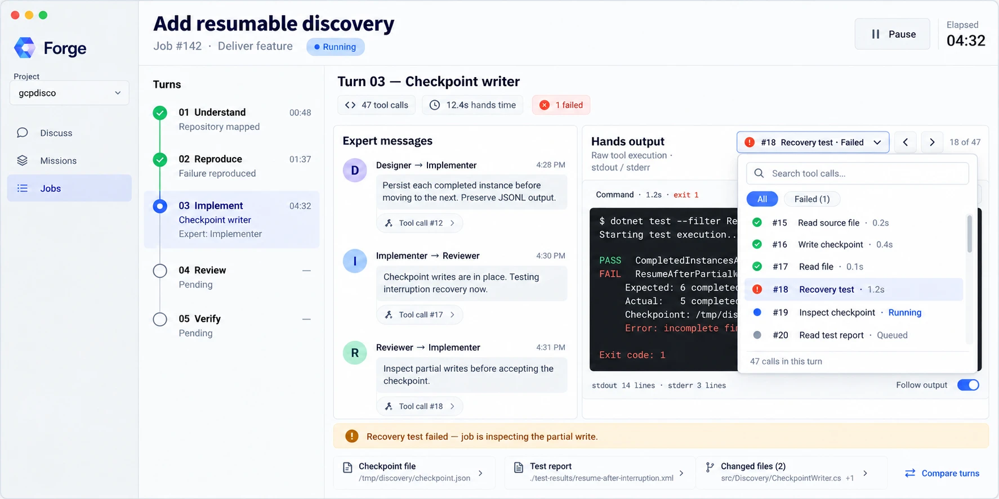
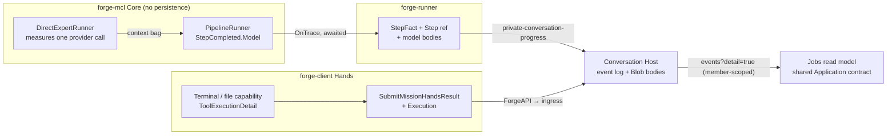

# Phase 78 — Full-fidelity run detail (draft for review)

> **Status: DRAFT design, not build-ready.** Written 2026-11-10 from a code read of forge-mcl
> `68c0846`, forge-runner `12e0081`, forge-conversations `33b66ef`, forge-client `2caee9b`, and one
> live run. The open questions in [§5](#5-open-questions) block the handoff. Not linked from
> `plan.md` yet.

## Goal

Store every detail of a mission run durably, so a user can later open a **Jobs** screen and inspect
their own runs: steps, model calls, tool calls, the Hands output, expert handoffs, artifacts, and
totals. Nothing is sampled and nothing is dropped. OpenTelemetry stays an optional operator export,
fed from the same points.

## Mockups (high-level reference, not final)

Shared by the operator on 2026-11-14 to show the intended flow: Discuss → Missions → Prepare run →
Runs → run detail → Jobs detail. They are references for this phase, **not** the binding visual
reference that [Q1](#5-open-questions) asks for. The Jobs detail screen (7) is the one this phase
captures data for.

| # | Screen | Image |
|---|---|---|
| 1 | Discuss: chat and work item draft | [1-discuss.webp](../images/phase-78/1-discuss.webp) |
| 2 | Missions list | [2-missions.webp](../images/phase-78/2-missions.webp) |
| 3 | Prepare run | [3-prepare-run.webp](../images/phase-78/3-prepare-run.webp) |
| 4 | Runs, grouped by status | [4-runs.webp](../images/phase-78/4-runs.webp) |
| 5 | Run that needs input | [5-run-needs-input.webp](../images/phase-78/5-run-needs-input.webp) |
| 6 | Run ready for review | [6-run-ready-for-review.webp](../images/phase-78/6-run-ready-for-review.webp) |
| 7 | Jobs detail: turns, expert messages, Hands output, tool calls | [7-jobs-detail.webp](../images/phase-78/7-jobs-detail.webp) |

**Out of scope here, to be managed later:** the mockups also show things this phase does not
capture: run control (Pause/Stop), human decisions (the "Decision needed" card, captured decisions,
the source discussion), acceptance criteria and their verification results, commits and pull
requests, and a "needs your input" run status. They also leave open what a "phase" is (turn 03 on
screen 7 spans three experts), use different phase lists on different screens, and say both "Runs"
and "Jobs".

## Live evidence (2026-11-10)

Installed CLI `0.30.0+68c0846`, default endpoint, a fresh project at
`~/Forge/Projects/p-rundetail-1110`.
`forge run --verbose ./detail.mcl "Create notes.txt containing the line: run detail probe"` ran
`Writer -> Reviewer -> Counter` (two LLM agents and one `exec` step). Exit code 0, 36 s,
conversation `298823aa-b84b-5413-994f-d5be87dd9454`. Its
`~/.forge/sessions/<projectId:N>/<conversationId:N>/messages.jsonl` held 25 events:

| Seen | Meaning for the design |
|---|---|
| `participant` is `"forge"` on every event. The expert appears only as `text: "Detail:Writer"` on `participantStarted`. | There is no typed step identity on any event. |
| `participantStarted` for Writer appears **twice** and Reviewer **three times**, all `attempt: 1`: one per round after a tool result. | A turn in the screen is a group of rounds, not one event. |
| `participantMessage text: ""` before the first tool call | Empty pre-tool replies are stored. |
| `missionHandsRequested` has `toolName`, full `arguments`, `providerToolCallId`, `missionLocation`, `agentLocation` | Tool requests are already complete. |
| `missionHandsInFlight` then `missionHandsResult` (`text` = content, `missionHandsOutcome`). The failed read shows `reason: "File not found: missing.txt"`. | Start/end times can be read from the two `occurredAtUtc` values (~0.25 s). There is no structured result. |
| `exec` step Counter: `participantStarted` and `participantMessage "words=8"`, then a duplicate final `participantMessage` with no attempt | Non-LLM steps do produce events. The run's final answer is a separate event. |
| No token counts, model, request messages or step end time anywhere | These are the gaps. |

## 1. What exists today, per screen element

| Screen element | Exists today | Missing | Evidence |
|---|---|---|---|
| Turn list (expert, time) | `ParticipantStarted` with `"Mission:Expert"` as text and `Attempt`. The timestamp is the runner's clock when it builds the fact. | Typed MissionPath, ExpertName, ExpertKind, StepKey. The runner drops them all. | runner `MissionCommandProcessor.cs:320-333`; `ConversationFacts.cs:87-89`; Core `PipelineTraceEvent.cs:14-22` |
| Step status and full output | `ParticipantMessage` (pass) or `Error` (fail), with the full text as a body | `Envelope.Status`, and on failure `Reason` *and* `Text`, because only one is kept. `Meta` is dropped (it is never set). | `MissionCommandProcessor.cs:326-329`; Core `StepEnvelope.cs:6-10` |
| Step start/end time | Event `OccurredAtUtc` (runner clock) | Core has no timestamps. End time is never recorded on its own, only implied by the message event. | Core grep: no `DateTime` in Runtime |
| Model request/response | Nothing durable. Usage is summed per run into one log line and the billing settlement. `gen_ai` spans have sensitive data off. | Messages sent, reply, model, finish reason, and per-call tokens | Core `DirectExpertRunner.cs:83` (usage discarded); runner `RunnerExpertRunnerFactory.cs:21-33`; `ModelRequestShapeLogger.cs:30-45` |
| Tool calls the model asked for | Root call: `MissionHandsRequested`, complete | `PipelineToolRequested` and `RootToolCheckpointed` are dropped (`StepFact` → null). The Hands request makes this harmless today. | `MissionCommandProcessor.cs:330`; `MissionHandsContracts.cs:141-149` |
| Tool status: requested / running / succeeded / failed / cancelled | `MissionHandsRequested`, `InFlight`, `Result` (7-value outcome), `Cancelled`, `Interrupted` | There is no *queued* state, and it can't happen: one outstanding call per pause. | Core `PipelineRunner.cs:561,592`; `PipelineToolPause.cs:117-119` |
| Tool duration | Can be read from InFlight → Result timestamps. This is an inference: they are Host commit times, so they include network time. | Measured execution time | — |
| Hands result: command, exit code, stdout, stderr, line counts | The command is in the request arguments (`Bash.command`). The result is one string. | The terminal merges stdout then stderr and puts the exit code in the text only when it is non-zero. `ToolExecutionResult` is `(Content, IsError)`. | client `ProjectBoundTerminalProvider.cs:65-68`; Core `IToolExecutor.cs:19` |
| Terminal reachable at all | **No default path produces terminal calls.** `forge run` uses `ProjectWorkspace` (Read/Write/Edit), and nothing in forge-mcl selects `ProjectWorkspaceAndTerminal`. | A surface that grants the terminal profile | [default-path](../design/default-path-acceptance.md#forge-run-hands-default--phase-76); grep for `ProjectWorkspaceAndTerminal` finds it only in forge-client and contracts |
| Messages between experts (sender → receiver) | Each step's output is a `ParticipantMessage`. | No message concept exists. Handoff runs through `context["output"]`, `with` bindings and `SpeakerTranscript`, so the receiver is implicit. | Core `PipelineRunner.cs:289,306,298-299` |
| Link message → tool call #N | Ordering is by sequence. Because only one call is outstanding, a `MissionHandsRequested` always follows the message of the step that caused it. | Explicit link | live run seq 4→5, 11→12, 16→17 |
| Artifacts / changed files | `Artifact` events for `exec` outputs; `MissionProducedFile(…, ProducingStepKey, ProducingAttempt)` | Hands Write/Edit are visible only as requests. Terminal side effects are invisible. Nothing tracks changed files. | `MissionCommandProcessor.cs:165-174`; `MissionProducedFiles.cs:8` |
| Totals: calls, Hands time, failures | `ProjectRunSummary.ToolCalls` / `ExpertTurns`, for Project-container runs only | No summary for Mission conversations (the ones `forge run` creates) | `ConversationContracts.cs:433-436, 477-478` |
| Latest-failure banner | `Error` events; `MissionHandsResult` with a failed outcome | — (can be derived) | — |
| Pause | — | `ConversationRunStatus` has no Paused value. Turn cancel exists. | `ConversationContracts.cs:82-93` |
| Compare turns | — | — (can be derived from stored rounds) | — |
| Run list (Jobs) | `ListMissionConversations(ProjectId)` → `MissionConversationSummary`. Every `forge run` makes a new conversation. | No caller in forge-client; no counts | `ConversationContracts.cs:477-480`; [phase-76](phase-76-unified-cloud-run_completed.md) |

### Findings that change the agreed direction

| Direction item | Finding | Change |
|---|---|---|
| "Nothing emitted when `ResumeAsync` brings a tool result back" | The **Host** already records the result durably as `MissionHandsResult`, with its full outcome and bodies (`ConversationGrain.cs:734-747`). Core would only repeat it. | No Core resume event. |
| Model client wrapper vs `OnTrace` | One `DirectExpertRunner` call makes **exactly one** provider call. There is no function-invocation loop, because every tool call pauses (`DirectExpertRunner.cs:83-90`; `PipelineRunner.cs:532`). Parallel LLM branches can run at the same time (`PipelineRunner.cs:354`), so a wrapper around the shared client cannot tell steps apart without ambient state. | Capture inside `DirectExpertRunner` and hand it to `PipelineRunner` through the context bag it already uses for `ResponseMessages` (`PipelineRunner.cs:529`). Emit it on `PipelineStepCompleted`. That gives the step key exactly, with no ambient state and no new mechanism. |
| Add new conversation event kinds | Readers **fail on an unknown kind** (`ConversationContracts.cs:368-370`), but **ignore unknown properties** (default System.Text.Json, no `UnmappedMemberHandling`). `ChatSessionProjection` turns itself off when it sees a sequence gap, so filtering new kinds out of the sequence would break it. | Add **optional trailing fields and body slots to existing kinds**, not new kinds. |
| Tool output chunked with byte offsets, local outbox | The terminal uses `ReadToEndAsync` (`ProjectBoundTerminalProvider.cs:56-57`), so nothing streams. The result submit already has a deterministic, idempotent `CommandId` (`ConversationDeterministicIds.cs:40-46`), but nothing retries it. A failed submit loses the output. | v1: bounded retry of the same submit. Chunked live tailing and a disk outbox wait for a terminal path that exists ([§5](#5-open-questions)). |
| OpenTelemetry stays optional | It is already wired in the runner and stays as it is. | No change. |

## 2. Recommended design

### Event shape: existing kinds, new optional fields

| Addition | On which events | Fields | Emitted by | Stored as |
|---|---|---|---|---|
| `ConversationStepRef? Step` | `ParticipantStarted`, `ParticipantMessage`, `Error` (step-scoped), `Artifact` | `MissionPath string[]`, `ExpertName`, `ExpertKind`, `StepKey`, `Attempt`, `Status` (the envelope status, on message/error only) | runner `StepFact`, from the trace base fields it drops today | Inline (small) |
| `ConversationModelCall? Model` | `ParticipantMessage` / `Error` of an LLM step | `Provider`, `ModelId`, `FinishReason`, `InputTokens`, `OutputTokens`, `CacheReadTokens?`, `CacheWriteTokens?`, `DurationMs`, `StartedAtUtc`. Body refs: `Request` (the messages and tool schemas sent, as JSON) and `Response` (the reply messages, including tool-call content, as JSON) | Core `DirectExpertRunner` measures → `PipelineStepCompleted.Model` → runner | Scalars inline; request/response as **bodies** (new slots `ModelRequest`, `ModelResponse`) |
| `Reason` alongside `Text` | step `Error` | Keep both the envelope `Text` and `Reason` instead of `Reason ?? Text` | runner `ConversationFacts.Error` | Existing body slots |
| `MissionToolExecution? Execution` | `MissionHandsResult` | `StartedAtUtc`, `DurationMs` (measured around `DispatchAsync`), `ExitCode?`, body refs `Stdout?`, `Stderr?` (terminal only) | forge-client `MissionHandsConversationService`, from a new `ToolExecutionDetail` | Scalars inline; stdout/stderr as bodies (new slots) |

`Content` and `Reason` on the Hands result stay exactly as they are today. The model still sees the
merged text, so model behaviour does not change.

**Stored once vs derived on read (locked):**

| Item | Rule |
|---|---|
| Turn | Consecutive rounds with the same `StepKey` + `Attempt` |
| Expert → expert message | A step's final message, labelled `sender → next started step in the same MissionPath`. Shown only for a sequential handoff (see Q6). |
| Tool call #N | Ordinal of `MissionHandsRequested` in the run, linked to the step message just before it. This relies on the one-outstanding-call rule; a future multi-call design must add `StepKey` to `MissionToolRequest`. |
| Line counts | Counted from the stdout/stderr bodies |
| Changed files | Succeeded Write/Edit paths plus `Artifact` events. Terminal changes: Q5. |
| Totals | Tool calls = count of requests. Hands time = Σ `Execution.DurationMs`. Failures = failed or denied outcomes + `Error` events. |
| Timestamps | The runner clock when the fact is built. This happens inside the awaited `OnTrace`, before any send (inference: within milliseconds of the step boundary). Core gets no clock. |

### Store and read

| Concern | Design | Evidence it already works |
|---|---|---|
| Durable order | The Host event log, one partition per conversation, one Table transaction per commit, contiguous sequence | `AzureTableConversationEventStore.cs:59-81` |
| Large content | Existing claim-check bodies in Blob, SHA-256 verified, deterministic id per owner and field, 4 MiB guardrail; **rejected, never truncated** | `ConversationBodies.cs:16-25`; `AzureBlobConversationBodyStore.cs:29-49` |
| Idempotency | Deterministic event ids (runner ordinal, client `CommandId`) plus receipt rows | `ConversationGrain.cs:1029-1040` |
| Live view | SSE from the `after` cursor; replay → subscribe → replay; gap fill | `ConversationSseWriter.cs:73-117` |
| Detail on demand | New flag `detail=true` on the Host events and SSE routes, forwarded by ForgeAPI as `IncludeDetail` (the same pattern as `IncludeDeltas`). Without it the hydrator **skips the new body slots**, so chat clients pay nothing extra. | `ConversationEndpoints.cs:277-280` (forge-platform) |
| Run list | `ListMissionConversations(ProjectId)` as it is; counts come from the read model on open. A summary column is Q7. | `ConversationContracts.cs:477-480` |
| Ownership | No new access model. Every Host route is member-scoped through `X-Forge-Member-Id`, which only the edge sets, and the address is built from the member, so another member's conversation reads as not found. | Host `ConversationEndpoints.cs:503-522` |
| Jobs read model | A shared Application contract in forge-client (`RunDetail` built by folding events), so a TUI and a GUI share one fold ([presentation parity](../design/engineering-philosophy.md#presentation-surface-parity-gate)) | — |

### Architecture-security gate

| Question | Answer |
|---|---|
| Bounded context / data owner | Conversation context; the Conversation Host owns `forgeconversationevents` and the `forgeconversationartifacts` blobs. No new store. |
| Public entry point | ForgeAPI (forge-platform), Bearer platform key; existing query routes gain `IncludeDetail`. |
| Tier 2 | The Host (internal ingress), forge-runner (through the progress queue), Billing (unchanged). |
| Tier 3 | The same Table, Blob and queues. No new identity or role. |
| Cross-store access? | No. Tokens come from the runner's own `UsageDetails`, not the Billing ledger. |
| Secrets | Unchanged. Request bodies can contain the mission's system prompts: Q8. |
| Type 1 / Type 2 | Contract additions are Type 1, cross-context, and are locked here. The `detail` flag name and the retry count are Type 2. |
| Enforcement | Existing member scoping. Verification: a detail read with another member's id returns 404 (Done when 4). |

### Failure boundaries

| Failure | Owner | Visible result | Recovery |
|---|---|---|---|
| A detail body over 4 MiB (model request, stdout) | The producer, before it sends | The step/run fails with a named reason, as an over-cap step output does today (`MissionCommandProcessor.cs:318-319`). Never silent truncation. | Q2 decides the cap |
| A detail fact fails to publish | runner outbox | Same as today: `WorkerOutboxFailureException`, the message is redelivered | Broker redelivery |
| Hands result submit fails | forge-client | Today: the output is lost and only a report line remains. v1: a bounded retry of the same `CommandId`, then the existing report line | The Host's idempotent replay |
| Body missing on read | Host hydrator | 503 / end of the SSE stream, never half-filled (`ConversationBodyHydrator.cs`) | Client reconnects |

### Engineering-philosophy check

| Smell | Answer |
|---|---|
| New mechanism? | No. It reuses `OnTrace`, the context-bag runtime keys, body slots, member scoping and SSE. |
| New knob? | One read flag, `detail`, needed so the default chat stream does not carry detail. |
| Ambient state? | Avoided. The model call is attached to the step result, not to an `AsyncLocal`. |
| Duplicate owner? | Tool results stay Host-recorded only. Tokens are measured once per call, in Core's existing call site. |

## 3. Smallest contract changes

| # | Repo / package | Change | Why |
|---|---|---|---|
| C1 | forge-mcl Core | `PipelineModelCall(string? ModelId, string? FinishReason, PipelineTokenUsage Usage, DateTimeOffset StartedAtUtc, TimeSpan Duration, JsonElement Request, JsonElement Response)`; `PipelineStepCompleted.Model { get; init; }` (nullable); `DirectExpertRunner` writes it to a new runtime context key, which `PipelineRunner` removes in its existing `finally` | Per-call model detail with exact step correlation. Microsoft.Extensions.AI types serialise through the AOT-safe `AIJsonUtilities` (inference: confirm under `-warnaserror`). Core still persists nothing. |
| C2 | forge-mcl Core | `ToolExecutionResult` gains `ToolExecutionDetail? Detail` = `(int? ExitCode, string? Stdout, string? Stderr)` | The only place exit code and separate streams exist is the terminal provider. |
| C3 | forge-client ClientRuntime | `ProjectBoundTerminalProvider` fills `Detail`; `MissionHandsConversationService` times the dispatch and sends `Execution`; bounded submit retry | Capture at the source; stop losing output on a failed submit. |
| C4 | forge-conversations Contracts | `ConversationStepRef`, `ConversationModelCall`, `MissionToolExecution`; optional trailing fields on `ConversationEvent`, `ConversationProgress` and `SubmitMissionToolResultRequest`; new body slots; `IncludeDetail` on the events queries | Typed, durable, backward-compatible (unknown properties are ignored). |
| C5 | forge-conversations Host | Persist and hydrate the new slots; skip them unless `detail=true` | The store. |
| C6 | forge-runner | `StepFact` forwards `Step` and `Model`; `Error` keeps both Text and Reason | It drops these fields today. |
| C7 | forge-platform | Offload the stdout/stderr bodies on `SubmitMissionHandsResult`; forward `IncludeDetail` | The edge does the body chunking today (`ConversationEndpoints.cs:66-67`). |

Release order follows the package graph: Core → Contracts → Host/runner/client → platform → CLI.

## 4. Locked decisions (proposed, need sign-off)

1. Typed product events in the Host event log are the user's record; OpenTelemetry is unchanged and optional.
2. No new event kinds: add optional fields and body slots to existing kinds.
3. Model calls are captured in Core's one call site and carried on `PipelineStepCompleted`.
4. No Core resume event: the Host's `MissionHandsResult` is the record.
5. Handoffs, turns, tool-call numbers and totals are derived on read, not stored.
6. Oversized detail fails loudly with a named reason; nothing is truncated.
7. No "Queued" tool state while the one-outstanding-call rule holds.

## 5. Open questions

| # | Question | Recommendation |
|---|---|---|
| Q1 | Where does the Jobs screen live? Desktop is on Contracts 0.4.0, its Hands are broken and its run history was deleted (forge-client `917d66f`). ForgeUI (forge-rooms) does not use the Host. | Build the shared read model first. Choose the surface with the operator, then bind the mockup as the [visual reference](../design/desktop-interaction-principles.md#visual-reference-acceptance-gate--non-negotiable) (saved under `docs/images/phase-78/`). |
| Q2 | Size: keep the 4 MiB body cap for model requests and stdout, or route large output through the existing content store (100 MiB, `MissionContentContracts.cs:31-33`)? | Keep 4 MiB in v1 and fail loudly. Revisit with real sizes. |
| Q3 | Retention: there is no TTL or delete path today for events or bodies. Detail multiplies storage. Each round re-sends the whole history, so request bodies grow quadratically. | Decide retention before enabling capture outside dev. Content-hash dedupe of request bodies is a later option. |
| Q4 | Terminal: there is no default path with the terminal profile, so exit code and stdout/stderr have no default-path producer. | Either scope v1 to file tools and model calls, or name the surface that grants `ProjectWorkspaceAndTerminal` as part of this phase. |
| Q5 | Changed files from terminal commands | Defer. File tools cover Write/Edit. |
| Q6 | The receiver for parallel branches and `with` bindings | Label only sequential handoffs in v1. |
| Q7 | Run-list counts: derive on open, or add counters to `MissionConversationSummary`? | Derive in v1. |
| Q8 | Request bodies include the expert system prompts. Is that acceptable for published missions whose prompts the author might not want shown? | Inference: the runner of a mission already holds its package. Needs an operator answer. |
| Q9 | Pause: there is no Paused status, and the runner is not told about a cancel. | Out of scope. It is a new run-control behaviour and needs its own design. |
| Q10 | Compare turns | Out of scope for v1. The stored rounds make it possible later. |

## 6. Default path

`forge run <mission.mcl> <prompt>` from the installed Native AOT CLI built from merged `main`, in a
dedicated `forge.project.json` folder. `FORGE_API_ENDPOINT` is absent, the runner and Host are
deployed through forge-infra `make` targets, and `ProjectWorkspace` Hands are used
([default facts](../design/default-path-acceptance.md#forge-run-hands-default--phase-76)). The
Jobs surface's own default is added once Q1 is answered.

## Done when

1. The installed `forge run` of a mission with two LLM agents and one `exec` step, a succeeded Write, a succeeded Read and a failed Read, run against the deployed services, reads back through ForgeAPI with `IncludeDetail`. Every `ParticipantStarted`, `ParticipantMessage` and `Error` has `Step` (with the correct StepKey); every LLM message has `Model` with non-zero tokens and a request body that contains the user prompt; every `MissionHandsResult` has `Execution.DurationMs`.
2. The same read **without** `IncludeDetail` is byte-identical in shape to today's, and the installed `forge chat` still writes `messages.jsonl`.
3. A model request body over 4 MiB fails the step with a named reason. This is a negative-path test at the runner layer.
4. A detail read with another member's id returns 404.
5. The Jobs read model, built from the run in step 1, shows 3 turns, 3 tool calls, 1 failure and Hands time equal to Σ `DurationMs`. Then the chosen surface passes its visual-reference gate (Q1).
